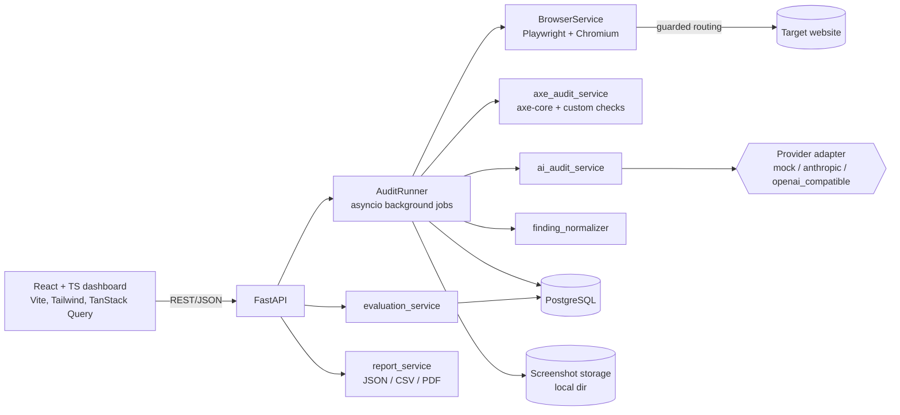
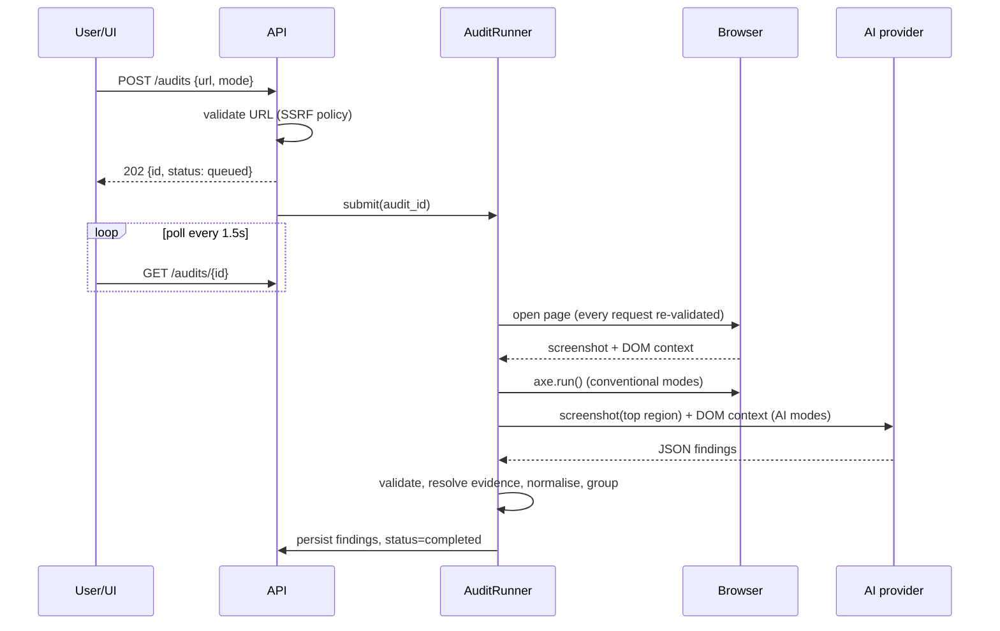
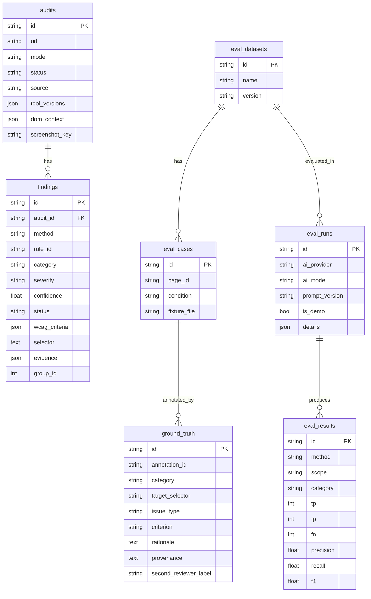

# Architecture

AccessAudit compares rule-based accessibility testing (axe-core + three labelled heuristics) with multimodal-AI analysis of the same rendered page. It is an **audit aid**, not a WCAG certification service.

## Components

| Layer | Module(s) | Responsibility |
|---|---|---|
| API | `app/api/routes/*`, `api/errors.py` | Validation, pagination, consistent `{error:{code,message,details}}` bodies, rate limiting |
| Security | `core/security.py`, `browser_service.py` | SSRF policy, DNS check, redirect + sub-request guard |
| Browser | `browser_service.py`, `assets/extract_dom.js` | Isolated context, screenshot, bounded DOM extraction |
| Conventional | `axe_audit_service.py` | axe-core (WCAG 2.x A/AA tags) + `custom-*` heuristics |
| AI | `ai_audit_service.py`, `ai_providers.py`, `prompts/audit_v1.md` | Prompt, provider call, strict validation, server-side evidence |
| Normalisation | `finding_normalizer.py` | Canonical selectors, grouping/matching, provenance |
| Evaluation | `evaluation_service.py`, `dataset/` | Ground truth matching, P/R/F1, confusion matrix, overlap |
| Reports | `report_service.py` | JSON/CSV (formula-injection safe)/PDF (escaped) |
| Persistence | `models/models.py`, `alembic/` | PostgreSQL schema + migrations |

## Audit workflow

AI failure never loses conventional results: in `combined` mode the audit completes with `ai_error` set; in `ai` mode it fails with a clear message.

## Database (ER)

Screenshots are files in a controlled directory (`LocalStorage`, path-confined, UUID-named); only the key is in PostgreSQL.

## Key design decisions

1. **Server-side evidence.** The model refers to elements by `ref` ids (`e12`). The server fills selector and HTML from its own DOM extraction, so a model cannot fabricate selectors or HTML. Unknown refs force `needs_manual_review` with confidence ≤ 0.3.
2. **AI cannot "confirm".** Only axe-core (deterministic) findings are `confirmed`. AI findings are `suspected` or `needs_manual_review`. Unknown WCAG criteria are dropped; findings without evidence are rejected; visual claims are discarded when no screenshot was sent.
3. **Matching** (conventional ↔ AI). Same group iff selectors are equal/ancestor-descendant **and** they share a category or WCAG criterion. Category alone never merges; selector-less findings never merge. Originals are preserved.
4. **Redirects are validated manually.** Chromium does not re-route redirects through Playwright handlers (found by our own test), so every request is fetched with `max_redirects=0`, the `Location` is validated, then the response is fulfilled and the browser's follow-up request is guarded again.
5. **In-process jobs.** `AuditRunner.submit` is the job abstraction (asyncio tasks, semaphore, pending cap, restart recovery marks interrupted audits failed). No Redis/Kafka: unnecessary at this scale.
6. **Demo mode.** `AI_PROVIDER=mock` runs simple rules over the real DOM and emits schema-valid JSON. Every audit/eval run it touches is flagged `demo` in the DB, UI and reports.

## Security summary (what is and is not covered)

Implemented and tested: scheme/port/credential restrictions; blocked hostnames/suffixes; DNS resolution with **all** answers checked against private/loopback/link-local/multicast/reserved/CGNAT/IPv4-mapped/6to4 ranges; numeric host tricks; per-request guard in the browser (sub-resources, redirects); request budget; websocket/media blocked; downloads and service workers off; permissions empty; no debugging port; CORS allow-list; rate limiting; path-confined storage; CSV formula neutralisation; PDF escaping; secrets only in backend env, redacted in logs; prompt-injection hardening (untrusted-data framing, delimiter stripping, schema validation).

Known limits: DNS rebinding is mitigated, not eliminated (check and connect are separate lookups; production should add an egress firewall or pinned-IP proxy). No authentication (see README). Chromium runs with `--no-sandbox` in the container profile; the container is the sandbox.
